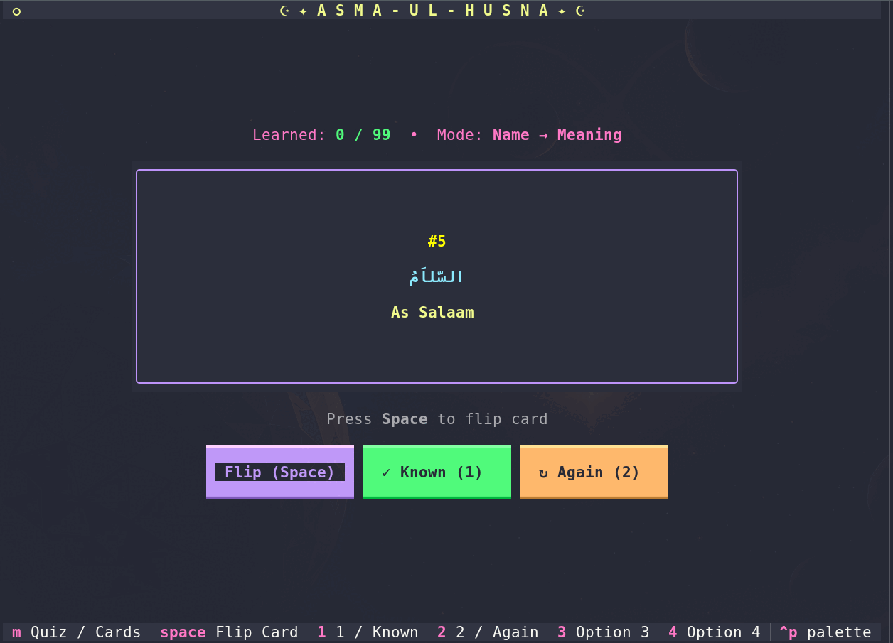
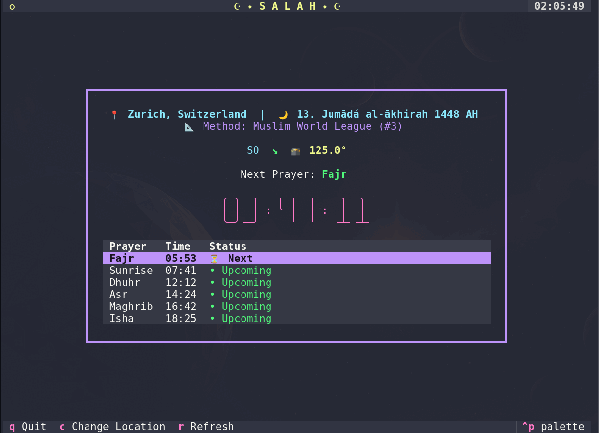

# ☪ Asma-ul-Husna TUI

A sleek terminal user interface (TUI) for learning the **99 Names of Allah** featuring an interactive **🔥 Streak Quiz Mode** and flashcards, built with [Textual](https://textualize.io) and the **Dracula** theme.

<p align="center">
  
</p>

## ✨ Key Features

- **🔥 Streak Quiz Mode (`m`):** Fast-paced multiple-choice quizzes (`1`–`4`) with instant feedback, live **Streak** tracking, and a **Best Streak** record.
- **🃏 Smart Flashcard Trainer (`Space`):** Flip through Arabic script, transliteration, and meanings, tracking progress as Known or Practice Again.
- **🔄 Bidirectional Practice (`r`):** Practice *Name ↔ Meaning* in both flashcard and quiz modes.
- **🔍 99-Names Directory (`l`):** Browse, filter, and inspect all names with completion indicators (`✓`).
- **💾 Offline Cache (`x`):** Uses the [AlAdhan Asma Al Husna API](https://aladhan.com) with local caching in `~/.config/asma-tui/`.

## 📦 Installation & Usage

Install via [pipx](https://pypa.io):
```bash
pipx install git+https://github.com/postsonde/asma-tui
```
Run the application:
```bash
asma
```

### Keyboard Shortcuts

| Key | Action |
| :--- | :--- |
| `m` | Switch to **Streak Quiz** / Flashcards |
| `Space` | Flip card / Next question |
| `1`–`4` | Answer options / Mark progress |
| `r` | Reverse practice direction |
| `l` | Open 99-names directory |
| `x` | Reset progress & streak |
| `q` | Quit |

## 📄 License
GNU General Public License (GPLv3)

---

## ☪ Islamic Terminal Suite (Dracula Theme)

A minimalist suite of Islamic terminal applications built with Python & [Textual](https://textualize.io), styled in the [Dracula](https://draculatheme.com) dark theme.

<p align="center">
  
</p>

| App | Command | Description |
| :--- | :--- | :--- |
| **[salah-tui](https://github.com/postsonde/salah-tui.git)** | `salah` | Islamic prayer times with live countdown, Hijri date & calculation methods |
| **[hijri-tui](https://github.com/postsonde/hijri-tui.git)** | `hijri` | Native Hijri calendar with lunar phases, Sunnah fasting & holy days |
| **[quran-tui](https://github.com/postsonde/quran-tui.git)** | `quran` | Study the Holy Quran with 100+ translations, side-by-side view & bookmarks |
| **[asma-tui](https://github.com/postsonde/asma-tui.git)** | `asma` | Learn the 99 Names of Allah with flashcards, streak quiz & directory |
